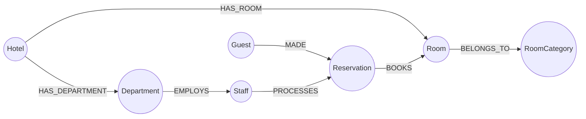

# Hotel Management System — Neo4j Graph Database
## DBMS Digital Assignment 3 (DA3) — Academic Project

A complete, production-grade **Hotel Management System** built using **Neo4j** (Graph Database) and **FastAPI** (Python), extending the relational schema from DA1 and SQL implementation from DA2.

---

## 📋 Project Context

- **Academic Context**: B.Tech CSE — Database Management Systems Digital Assignment 3 (DA3)
- **Objective**: Extend the 7-entity Hotel Management System into an advanced non-MongoDB NoSQL database technology, demonstrate core operations and graph-specific queries, and provide a comparative analysis.
- **Selected Technology**: **Neo4j Graph Database** using **Cypher Query Language** (openCypher standard).

---

## 🏗 System Architecture & Tech Stack

| Layer | Technology | Description |
|---|---|---|
| **Database** | Neo4j 5.x+ (Local or Neo4j Aura) | Native Graph DB with Index-Free Adjacency (IFA) and In-Memory Simulator fallback |
| **Query Language** | Cypher | Declarative pattern-matching graph query language |
| **Backend API** | Python 3.10+ / FastAPI | High-performance asynchronous RESTful API |
| **Database Driver** | `neo4j` (Official Python Driver) | Thread-safe connection pooling, session management, and write transactions |
| **Frontend UI** | HTML5 / Vanilla CSS3 / JavaScript | Responsive Glassmorphism dashboard with zero external UI dependencies |
| **Testing Suite** | `pytest` + `httpx` | Offline schema, route unit tests, concurrency tests, and live Neo4j integration tests |

---

## 🌐 Graph Data Model

The graph model preserves the 7 core entities from DA1/DA2, transforming relational foreign keys into first-class directed relationships:




### Node Labels (7 Entities)
- `(:Hotel)`: `hotel_id` (Unique), `name`, `location`, `rating`
- `(:RoomCategory)`: `category_name` (Unique), `rent`
- `(:Room)`: `room_id` (Globally Unique Primary Key, e.g., 'RM101'), `room_no` (Hotel-local floor number), `status` ('Available', 'Occupied', 'Maintenance')
- `(:Department)`: `dept_id` (Unique), `d_head`, `d_role`, `contact_info`
- `(:Staff)`: `staff_id` (Unique), `name`, `age`, `salary`, `contact_info`
- `(:Guest)`: `guest_id` (Unique), `name`, `contact_info`, `nationality`, `gender`, `password`
- `(:Reservation)`: `res_id` (Unique), `check_in_date`, `check_out_date`, `total_amount`, `status` ('Confirmed', 'Active', 'Cancelled', 'Completed')

### Relationships (7 Connections)
- `(:Hotel)-[:HAS_ROOM]->(:Room)`
- `(:Room)-[:BELONGS_TO]->(:RoomCategory)`
- `(:Hotel)-[:HAS_DEPARTMENT]->(:Department)`
- `(:Department)-[:EMPLOYS]->(:Staff)`
- `(:Guest)-[:MADE]->(:Reservation)`
- `(:Reservation)-[:BOOKS]->(:Room)`
- `(:Staff)-[:PROCESSES]->(:Reservation)`

---

## 🌟 Implemented Core Features

### 1. Smart Room Availability and Booking
- **Multi-Criteria Search Interface**: Search rooms by Hotel, City/Location (`location`), Check-in date, Check-out date, Room Category, and Maximum Nightly Price (`max_rent`).
- **Strict Date Range Validation**: Validates that `check_out > check_in`. Single dates, inverted ranges, and same-day check-in/check-out attempts are rejected with `HTTP 400 Bad Request`.
- **Dynamic Availability Filtering**:
  - Excludes rooms currently marked with `status = 'Maintenance'`.
  - Excludes rooms with overlapping active reservations (`res.status IN ['Active', 'Confirmed']`) where `res.check_in_date < $check_out AND res.check_out_date > $check_in`.
  - Rooms occupied today remain available for non-overlapping future stays (does not rely on current snapshot status alone).
- **Pricing Calculation**: Automatically computes stay duration in nights and `estimated_total_price = nightly_rate * nights`.
- **Concurrency-Safe Booking**: Atomic booking creation using parameterized Cypher write transactions (`tx.run()`) with overlap verification to prevent double-booking.
- **Booking Confirmation Modal**: Displays stay details, total price, and a prominent, copyable reservation reference (e.g., `R009`).

### 2. Guest Self-Service Portal
- **Secure Guest Authentication & Registration**:
  - Enforces password verification for all guests. Users cannot log in merely by entering an email, phone number, or guest ID (`HTTP 401 Unauthorized` without valid password).
  - New guests can self-register with full name, email/phone, nationality, and password.
  - Sessions are bound in `localStorage` to the authenticated guest's database identifier (`guest_id`).
- **"My Reservations" Dashboard**:
  - Categorized tabs: **Upcoming Bookings** (`Active` / `Confirmed`), **Completed Stays** (`Completed`), and **Cancelled Bookings** (`Cancelled`).
  - Displays Reservation Reference, Hotel name & location, Room number & category, Stay dates, Stay duration, Price, and Status badge.
- **Self-Service Cancellations**:
  - Guests can cancel eligible active bookings directly with confirmation.
  - Room is immediately restored to available status for future bookings.
- **IDOR Protection (Insecure Direct Object Reference)**:
  - Backend verifies `caller_guest_id` against reservation ownership.
  - Attempts to view or cancel another guest's bookings return `HTTP 403 Forbidden`.
- **Role-Based Access Control**:
  - Staff and administrators retain full management access (all reservations, staff creation, manual room status overrides, graph visualizer).
  - Graph Visualizer is accessible to all logged-in roles for interactive academic demonstrations.

### 3. Live Backend Query Inspector (Live Academic Demo Terminal)
- **Real-Time Cypher Execution Capture**:
  - Intercepts and traces 100% of read and write queries executed against Neo4j (`execute_read`, `execute_write`, and multi-statement `run_write_transaction`).
  - Measures true database execution duration in milliseconds.
  - Captures exact Cypher statements, execution status (`SUCCESS` / `FAILURE`), record counts affected, and error messages.
- **Security & Privacy Protection**:
  - Parameterized queries are captured with parameters displayed separately.
  - Sensitive values (`password`, `admin_pwd`, `token`, `secret`) are automatically redacted to `********`.
- **Collapsible Bottom Terminal Interface**:
  - Docked at the bottom of the dashboard with a dark terminal aesthetic and neon pulse status indicator.
  - Expand/collapse toggle button keeps the main dashboard fully usable.
  - Live query counter badge, status filter (`All`, `Success`, `Failed`), search filter, and "Clear" action.
  - "Copy Cypher" quick button on every trace card.
  - Cypher keyword syntax highlighting (`MATCH`, `MERGE`, `RETURN`, `WHERE`, `WITH`, `CREATE`, etc.).
- **Zero Overhead & Zero Mock Data**:
  - Traces are streamed directly through response headers (`X-Backend-Trace`), avoiding redundant database polling.
  - Shows actual database executions only—never hardcoded or simulated templates.

---

## 📁 Repository Structure

```
dbms database project/
├── backend/
│   ├── main.py                     # FastAPI application entry point & trace middleware
│   ├── config.py                   # Environment settings & Neo4j driver factory
│   ├── database.py                 # Neo4j query execution manager with execution tracing
│   ├── query_tracer.py             # Query instrumentation, parameter masking & history buffer
│   ├── mock_store.py               # In-memory graph engine with Cypher pattern matching
│   ├── models/
│   │   └── schemas.py              # Pydantic validation models (Guest, Room, Reservation)
│   └── routers/
│       ├── dashboard.py            # Aggregate metrics & room availability
│       ├── hotels.py               # Hotel CRUD & room/department traversals
│       ├── rooms.py                # Smart availability search & status updates
│       ├── guests.py               # Secure guest auth, profile & reservation history
│       ├── reservations.py         # Atomic bookings with overlap protection & cancellation
│       ├── staff.py                # Staff directory & handling records
│       ├── recommendations.py      # Graph recommendation engine (multi-hop)
│       ├── graph.py                # Graph topology & network visualization API
│       └── query_inspector.py      # Query inspector history & clear endpoints
├── cypher/
│   ├── 01_constraints.cypher       # Uniqueness constraints & B-tree indexes
│   ├── 02_seed_data.cypher         # Idempotent dataset seeding via MERGE
│   ├── 03_crud_queries.cypher      # Standard insert, read, update, delete
│   ├── 04_traversal_queries.cypher # Multi-hop path traversal queries
│   ├── 05_aggregation_queries.cypher# Occupancy, revenue & staff analytics
│   ├── 06_recommendation_queries.cypher# Collaborative filtering queries
│   └── 07_reset.cypher             # Safe database cleanup script
├── frontend/
│   ├── index.html                  # Responsive Single-Page Application
│   ├── login.html                  # Secure dual-role login & registration page
│   ├── css/
│   │   ├── style.css               # Glassmorphism design tokens, terminal & inspector styles
│   │   └── login.css               # Login page layout and particle animations
│   └── js/
│       ├── api.js                  # API client with trace header interception
│       ├── auth.js                 # Role-based session management & auth client
│       ├── login.js                # Login controller with password validation
│       ├── app.js                  # SPA routing & event controllers
│       └── components/
│           ├── dashboard.js        # Aggregate metrics view
│           ├── hotels.js           # Hotel directory view
│           ├── rooms.js            # Smart availability search & booking confirmation
│           ├── guests.js           # Guest profile view (admin)
│           ├── reservations.js     # Guest Self-Service Portal & staff reservation table
│           ├── staff.js            # Staff & department view
│           ├── recommendations.js  # Recommendation engine view
│           ├── graph_visualizer.js # Canvas force-directed graph visualizer
│           └── query_inspector.js  # Collapsible Backend Query Inspector terminal
├── tests/
│   ├── conftest.py                 # Pytest configuration & fixtures
│   ├── test_unit_offline.py        # Offline schema & Cypher script tests
│   ├── test_connection.py          # Neo4j driver connectivity tests
│   ├── test_hotels.py              # Hotel endpoint tests
│   ├── test_rooms.py               # Smart room search & availability tests
│   ├── test_guests.py              # Guest auth, registration & IDOR tests
│   ├── test_reservations.py        # Concurrency, atomic booking & cancellation tests
│   └── test_query_inspector.py     # Tracing, parameter sanitization & transaction tests
├── requirements.txt                # Python dependencies
└── README.md                       # Project documentation
```

---

## 🚀 Setup & Execution Guide

### 1. Prerequisites
- Python 3.10 or higher installed
- Optional: Neo4j Desktop or Neo4j Community Server running on `bolt://localhost:7687` (system includes an automatic In-Memory Graph Simulator fallback if live Neo4j is offline).

### 2. Install Dependencies
```powershell
pip install -r requirements.txt
```

### 3. Start the Application Server
```powershell
uvicorn backend.main:app --reload --port 8000
```

### 4. Access the Application
- **Frontend Dashboard**: Open [http://localhost:8000](http://localhost:8000)
- **Login Portal**: Open [http://localhost:8000/login](http://localhost:8000/login)
- **Interactive Swagger Docs**: Open [http://localhost:8000/docs](http://localhost:8000/docs)

### 5. Default Credentials
| Role | Identifier / Username | Default Password | Notes |
|---|---|---|---|
| **Admin** | `admin` | `admin123` | Full administrative dashboard |
| **Existing Guest** | `G001` (or `G002`–`G008`) | `password123` | Access to Guest Portal & Booking |
| **New Guest** | *Any valid email / phone* | *Custom password* | Instant registration via login form |

---

## 🧪 Running Automated Tests

Run the complete test suite:
```powershell
pytest -v
```

### Test Suite Execution Summary
```
============================= test session starts =============================
platform win32 -- Python 3.12.10, pytest-7.4.3
collected 83 items

tests/test_connection.py::TestConnection::test_driver_connects SKIPPED
tests/test_connection.py::TestConnection::test_basic_query SKIPPED
tests/test_connection.py::TestConnection::test_health_endpoint PASSED
tests/test_dashboard.py (3 tests) PASSED
tests/test_guests.py (20 tests) PASSED
tests/test_hotels.py (5 tests) PASSED
tests/test_query_inspector.py (8 tests) PASSED
tests/test_reservations.py (16 tests) PASSED
tests/test_rooms.py (17 tests) PASSED
tests/test_unit_offline.py (11 tests) PASSED

================== 81 passed, 2 skipped, 0 failed in 12.23s ===================
```
- **81 Passed**: Cypher execution interception, parameter password redaction, transaction statement ordering, offline unit tests, Pydantic validations, date range verification, room availability filtering, IDOR protection, atomic booking concurrency, cancellation availability updates, and collaborative filtering.
- **2 Skipped**: Live Bolt driver connection tests that gracefully skip when a local Neo4j instance is not running on port 7687.

---

## 📸 How to Demonstrate the Features

### Demonstrating Feature 1: Smart Room Availability & Booking
1. Open [http://localhost:8000/login](http://localhost:8000/login) and sign in as a Guest (e.g. `G001` / `password123`).
2. Navigate to **Book Rooms** (`/rooms`) from the sidebar.
3. In the Smart Room Search bar:
   - Pick a Location (e.g. `Mumbai` or leave blank for all).
   - Select Check-in: `2026-10-20` and Check-out: `2026-10-23`.
   - Select Category: `Deluxe` and Max Nightly Price: `5000`.
4. Click **Search Available Rooms**:
   - The table displays matching available rooms, stay duration (`3 nights`), and estimated total price (`₹13,500`).
   - Notice rooms under maintenance or with active overlapping bookings are automatically excluded.
5. Click **Book Room** on any available room:
   - Review stay details and total price in the reservation modal.
   - Click **Confirm Reservation**.
6. View the **Booking Confirmation Screen**:
   - Displays the unique reservation reference (e.g., `R009`).
   - Use the **Copy** button to copy the reservation reference.
   - Click **View in My Reservations** to inspect the booking.

### Demonstrating Feature 2: Guest Self-Service Portal
1. Navigate to **My Reservations** (`/reservations`).
2. Under the **Upcoming Bookings** tab, observe your active reservation with reference ID, hotel name, location, dates, and total amount.
3. Click **Cancel Booking** on your upcoming reservation:
   - A confirmation dialog appears explaining that the room will be immediately released.
   - Click **Confirm Cancellation**.
   - Notice the booking moves to the **Cancelled Bookings** tab, and its status changes to `Cancelled`.
4. Re-run room availability search for the same dates:
   - Notice the room is immediately restored to available status.
5. **Security / IDOR Demonstration**:
   - Log in as guest `G002`. Attempting to access `GET /api/guests/G001/reservations?caller_guest_id=G002` or cancelling `G001`'s reservation returns `HTTP 403 Forbidden`.

### Demonstrating Feature 3: Live Backend Query Inspector (Academic Live Demo)
1. Open [http://localhost:8000](http://localhost:8000) or [http://localhost:8000/login](http://localhost:8000/login) in your browser.
2. Observe the **Backend Query Inspector** docked at the bottom of the screen:
   - Click the **Expand / Collapse** button (chevron) on the right side of the terminal header to open the panel.
   - Notice the live neon pulse indicator showing `Connected & Tracing`.
3. Perform any action in the dashboard:
   - **Search Available Rooms**: Click "Search" in `/rooms` — instantly watch the Cypher statement appear:
     ```cypher
     MATCH (h:Hotel)-[:HAS_ROOM]->(r:Room)-[:BELONGS_TO]->(c:RoomCategory)
     WHERE r.status <> 'Maintenance'
     ...
     ```
   - **View Dashboard Metrics**: Navigate to Dashboard — watch the 5 aggregate COUNT queries appear.
   - **Create / Cancel Reservation**: Watch the atomic write transaction display its verification and update statements in exact sequential order.
   - **Interactive Graph Visualizer**: Click "Graph Visualizer" — inspect the multi-hop graph topology extraction query.
4. Terminal Features to demonstrate to the professor / examiner:
   - **Separate Parameters**: Notice query parameters are displayed cleanly in JSON format, with sensitive keys like `password` automatically redacted as `********`.
   - **Measured Database Timing**: Real execution duration measured directly at the query execution layer (e.g. `2.41 ms`).
   - **Syntax Highlighting**: Keywords (`MATCH`, `WHERE`, `RETURN`, `WITH`) and parameters are color-coded in modern monospace font.
   - **Copy Cypher**: Click "Copy Cypher" on any card to copy the clean statement directly to the clipboard.
   - **Filter and Clear**: Filter by "Success" or "Failed", or search for specific keywords (e.g. `Reservation`), and click "Clear" to empty the terminal log.

---

## 📚 Academic Deliverables Index

All submission artifacts required for DA3 are located in the `docs/` folder:

1. [docs/da3_report_draft.md](file:///c:/Users/nalin/Desktop/dbms%20database%20project/docs/da3_report_draft.md) — Comprehensive draft ready for handwritten assignment notebook.
2. [docs/graph_model.md](file:///c:/Users/nalin/Desktop/dbms%20database%20project/docs/graph_model.md) — Formal Graph Data Model specification and constraint documentation.
3. [docs/demo_script.md](file:///c:/Users/nalin/Desktop/dbms%20database%20project/docs/demo_script.md) — Minute-by-minute demonstration script for evaluation.
4. [docs/viva_questions.md](file:///c:/Users/nalin/Desktop/dbms%20database%20project/docs/viva_questions.md) — 20+ viva voce questions with detailed answers.
5. [docs/screenshot_checklist.md](file:///c:/Users/nalin/Desktop/dbms%20database%20project/docs/screenshot_checklist.md) — Visual checklist of screenshots to capture from the running app.
