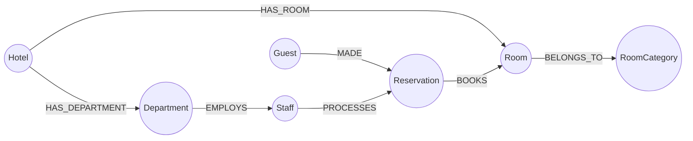
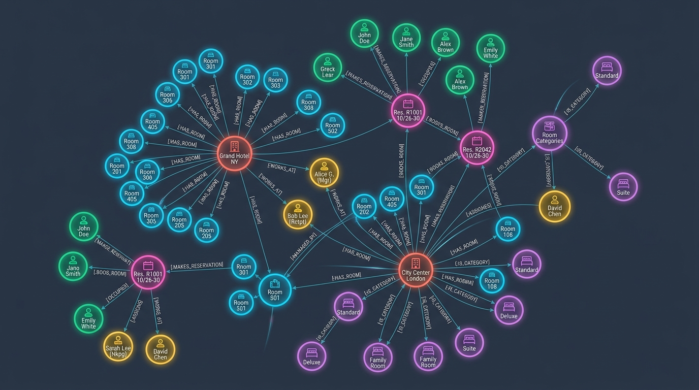

# Hotel Management System — Neo4j Graph Database
## DBMS Digital Assignment 3 (DA3) — Academic Project

A complete, production-grade **Hotel Management System** built using **Neo4j** (Graph Database) and **FastAPI** (Python), extending the relational schema from DA1 and SQL implementation from DA2.

---

## 📋 Project Context

- **Academic Context**: B.Tech CSE — Database Management Systems Digital Assignment 3 (DA3)
- **Objective**: Extend the 7-entity Hotel Management System into an advanced non-MongoDB NoSQL database technology, demonstrate core operations and graph-specific queries, and provide a comparative analysis.
- **Selected Technology**: **Neo4j Graph Database** using **Cypher Query Language** (openCypher standard).

---

## 🏗 System Architecture & Tech Stack

| Layer | Technology | Description |
|---|---|---|
| **Database** | Neo4j 5.x+ (Local or Neo4j Aura) | Native Graph DB with Index-Free Adjacency (IFA) |
| **Query Language** | Cypher | Declarative pattern-matching graph query language |
| **Backend API** | Python 3.10+ / FastAPI | High-performance asynchronous RESTful API |
| **Database Driver** | `neo4j` (Official Python Driver) | Thread-safe connection pooling and session management |
| **Frontend UI** | HTML5 / Vanilla CSS3 / JavaScript | Responsive Glassmorphism dashboard with zero external UI dependencies |
| **Testing Suite** | `pytest` + `httpx` | Offline schema & route unit tests + Live Neo4j integration tests |

---

## 🌐 Graph Data Model

The graph model preserves the 7 core entities from DA1/DA2, transforming relational foreign keys into first-class directed relationships:






### Node Labels (7 Entities)
- `(:Hotel)`: `hotel_id` (Unique), `name`, `location`, `rating`
- `(:RoomCategory)`: `category_name` (Unique), `rent`
- `(:Room)`: `room_no` (Unique), `status` ('Available', 'Occupied', 'Maintenance')
- `(:Department)`: `dept_id` (Unique), `d_head`, `d_role`, `contact_info`
- `(:Staff)`: `staff_id` (Unique), `name`, `age`, `salary`, `contact_info`
- `(:Guest)`: `guest_id` (Unique), `name`, `contact_info`, `nationality`, `gender`
- `(:Reservation)`: `res_id` (Unique), `check_in_date`, `check_out_date`, `status` ('Confirmed', 'Cancelled', 'Completed')

### Relationships (7 Connections)
- `(:Hotel)-[:HAS_ROOM]->(:Room)`
- `(:Room)-[:BELONGS_TO]->(:RoomCategory)`
- `(:Hotel)-[:HAS_DEPARTMENT]->(:Department)`
- `(:Department)-[:EMPLOYS]->(:Staff)`
- `(:Guest)-[:MADE]->(:Reservation)`
- `(:Reservation)-[:BOOKS]->(:Room)`
- `(:Staff)-[:PROCESSES]->(:Reservation)`

---

## 📁 Repository Structure

```
dbms database project/
├── backend/
│   ├── main.py                     # FastAPI application entry point
│   ├── config.py                   # Environment settings & Neo4j driver factory
│   ├── database.py                 # Neo4j query execution manager
│   ├── models/
│   │   └── schemas.py              # Pydantic validation models
│   └── routers/
│       ├── dashboard.py            # Aggregate metrics & room availability
│       ├── hotels.py               # Hotel CRUD & room/department traversals
│       ├── rooms.py                # Room search & status updates
│       ├── guests.py               # Guest management & reservation history
│       ├── reservations.py         # Atomic bookings with overlap protection
│       ├── staff.py                # Staff directory & handling records
│       ├── recommendations.py      # Graph recommendation engine (multi-hop)
│       └── graph.py                # Graph topology & network visualization API
├── cypher/
│   ├── 01_constraints.cypher       # Uniqueness constraints & B-tree indexes
│   ├── 02_seed_data.cypher         # Idempotent dataset seeding via MERGE
│   ├── 03_crud_queries.cypher      # Standard insert, read, update, delete
│   ├── 04_traversal_queries.cypher # Multi-hop path traversal queries
│   ├── 05_aggregation_queries.cypher# Occupancy, revenue & staff analytics
│   ├── 06_recommendation_queries.cypher# Collaborative filtering queries
│   └── 07_reset.cypher             # Safe database cleanup script
├── frontend/
│   ├── index.html                  # Responsive Single-Page Application
│   ├── css/
│   │   └── style.css               # Glassmorphism design tokens & styles
│   └── js/
│       ├── api.js                  # Asynchronous backend API client
│       ├── app.js                  # SPA routing & event controllers
│       └── components/
│           ├── dashboard.js        # Aggregate metrics view
│           ├── hotels.js           # Hotel directory view
│           ├── rooms.js            # Room inventory & filter view
│           ├── guests.js           # Guest profile & history view
│           ├── reservations.js     # Reservation management view
│           ├── staff.js            # Staff & department view
│           ├── recommendations.js  # Recommendation engine view
│           └── graph_visualizer.js # Canvas force-directed graph visualizer
├── scripts/
│   ├── seed.py                     # Automated Python database populator
│   └── reset.py                    # Database wipe utility with confirmation
├── tests/
│   ├── conftest.py                 # Pytest configuration & graceful skip fixtures
│   ├── test_unit_offline.py        # 10 offline unit tests (schemas, routes, Cypher)
│   ├── test_connection.py          # Neo4j driver connectivity tests
│   ├── test_hotels.py              # Hotel endpoint tests
│   ├── test_rooms.py               # Room search & status update tests
│   ├── test_guests.py              # Guest history & validation tests
│   ├── test_reservations.py        # Overlap prevention & cancellation tests
│   └── test_dashboard.py           # Metrics aggregation tests
├── docs/
│   ├── da3_report_draft.md         # Comprehensive draft for handwritten report
│   ├── graph_model.md              # Detailed Graph Schema specification
│   ├── demo_script.md              # Step-by-step viva presentation guide
│   ├── viva_questions.md           # 20+ oral viva questions with high-scoring answers
│   └── screenshot_checklist.md     # Checklist of screenshots for submission
├── .env.example                    # Template environment variables
├── .gitignore                      # Git ignore rules
├── requirements.txt                # Python dependencies
└── README.md                       # Project documentation
```

---

## 🚀 Setup & Execution Guide

### 1. Prerequisites
- Python 3.10 or higher installed
- Neo4j Desktop, Neo4j Community Server, or a free [Neo4j AuraDB](https://neo4j.com/cloud/platform/aura-graph-database/) instance.

### 2. Environment Configuration
Create a `.env` file from `.env.example`:
```powershell
Copy-Item .env.example .env
```
Edit `.env` with your Neo4j connection details:
```env
NEO4J_URI=bolt://localhost:7687
NEO4J_USER=neo4j
NEO4J_PASSWORD=your_password
PORT=8000
```
*(If using Neo4j Aura, set `NEO4J_URI=neo4j+s://<instance-id>.databases.neo4j.io`)*

### 3. Install Dependencies
```powershell
pip install -r requirements.txt
```

### 4. Seed the Database
Run the idempotent Python seeder to populate sample hotels, rooms, guests, staff, and reservations:
```powershell
python scripts/seed.py
```

### 5. Start the Application Server
```powershell
uvicorn backend.main:app --reload --port 8000
```

### 6. Access the Application
- **Interactive Web Dashboard**: Open [http://localhost:8000](http://localhost:8000)
- **Interactive API Documentation (Swagger)**: Open [http://localhost:8000/docs](http://localhost:8000/docs)
- **Alternative API Docs (ReDoc)**: Open [http://localhost:8000/redoc](http://localhost:8000/redoc)
- **Neo4j Browser (Graph Visualizer)**: Open [http://localhost:7474](http://localhost:7474)

---

## 🧪 Running Automated Tests

Run the full test suite with verbose output:
```powershell
pytest -v
```

- **Offline Unit Tests (10 tests)**: Validate Pydantic data schemas, status enums, route bindings, and Cypher file integrity. Always run and pass even when Neo4j is offline.
- **Live Integration Tests (39 tests)**: Connect to a running Neo4j instance to test live Cypher execution, double-booking prevention, and traversals. Automatically skip gracefully if Neo4j is not connected.

---

## 🌟 Key Graph-Specific Features

### 1. Index-Free Adjacency (IFA)
In SQL, traversing across 4 tables (`Guest` $\rightarrow$ `Reservation` $\rightarrow$ `Room` $\rightarrow$ `Hotel`) incurs repeated $O(\log N)$ index join penalties. In Neo4j, each node stores direct pointer references, executing multi-hop traversals in constant time $O(1)$ per hop.

### 2. Double-Booking Overlap Prevention
Atomic parameterized Cypher query checks for conflicting date ranges before creating a reservation:
```cypher
MATCH (res:Reservation)-[:BOOKS]->(r:Room {room_no: $room_no})
WHERE res.status = 'Confirmed'
  AND NOT (res.check_out_date <= date($check_in_date) 
        OR res.check_in_date >= date($check_out_date))
RETURN count(res) AS conflicts
```

### 3. Collaborative Guest Recommendation Engine
Surfaces hotel and room recommendations using a 6-hop bidirectional path:
$$(g_1:\text{Guest}) \to (\text{MADE}) \to (r_1) \to (\text{BOOKS}) \to (rm) \leftarrow (\text{BOOKS}) \leftarrow (r_2) \leftarrow (\text{MADE}) \leftarrow (g_2:\text{Peer})$$
Finds hotels enjoyed by peer guests with matching profiles that the target guest has not yet visited.

---

## 📚 Academic Deliverables Index

All submission artifacts required for DA3 are located in the `docs/` folder:

1. [docs/da3_report_draft.md](file:///c:/Users/nalin/Desktop/dbms%20database%20project/docs/da3_report_draft.md) — Comprehensive draft ready for your handwritten assignment notebook.
2. [docs/graph_model.md](file:///c:/Users/nalin/Desktop/dbms%20database%20project/docs/graph_model.md) — Formal Graph Data Model specification and constraint documentation.
3. [docs/demo_script.md](file:///c:/Users/nalin/Desktop/dbms%20database%20project/docs/demo_script.md) — Minute-by-minute demonstration script for your professor/evaluator.
4. [docs/viva_questions.md](file:///c:/Users/nalin/Desktop/dbms%20database%20project/docs/viva_questions.md) — 20+ viva voce questions with detailed answers.
5. [docs/screenshot_checklist.md](file:///c:/Users/nalin/Desktop/dbms%20database%20project/docs/screenshot_checklist.md) — Visual checklist of screenshots to capture from the running app.
